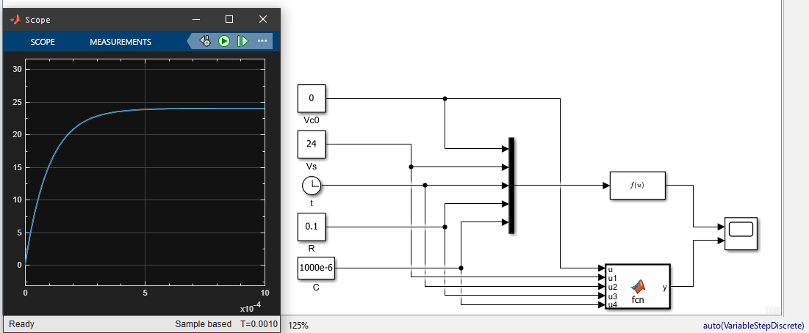
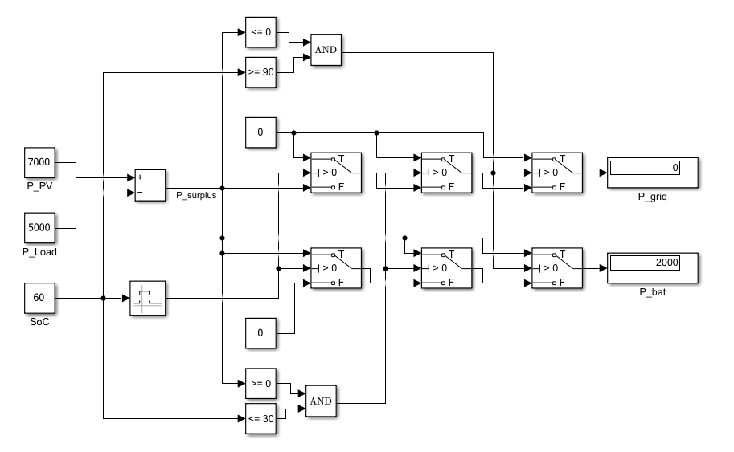
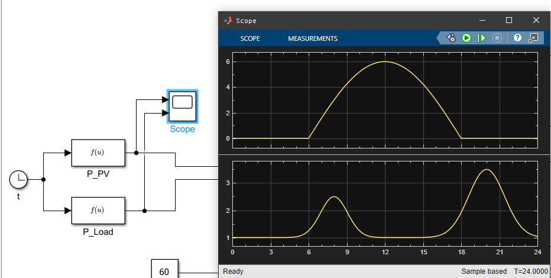
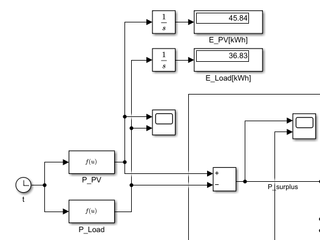
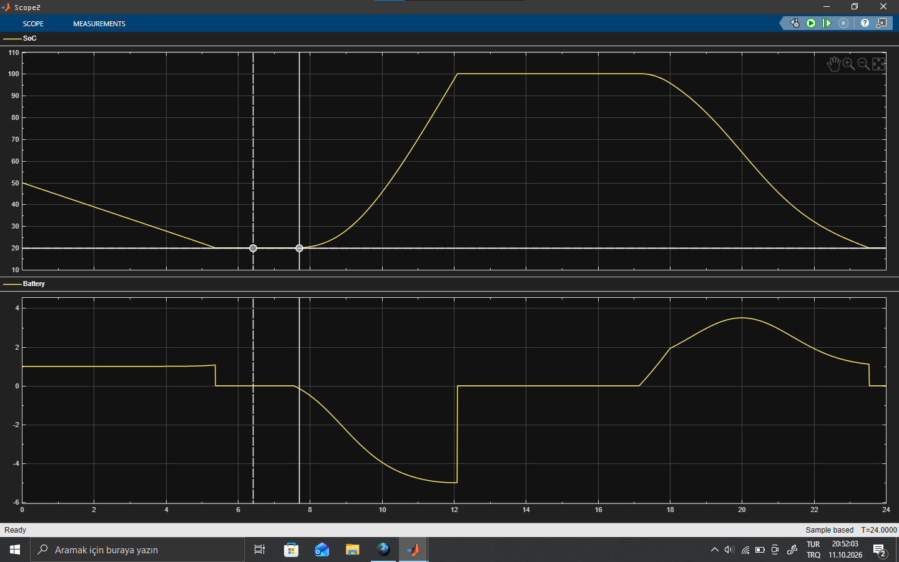
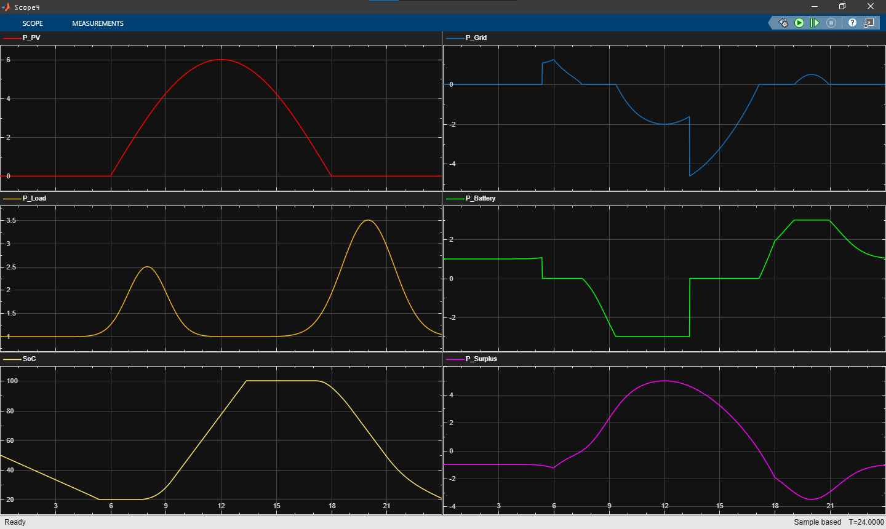
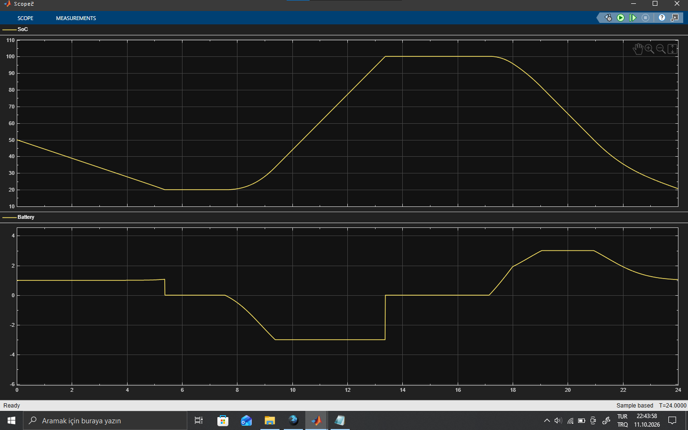
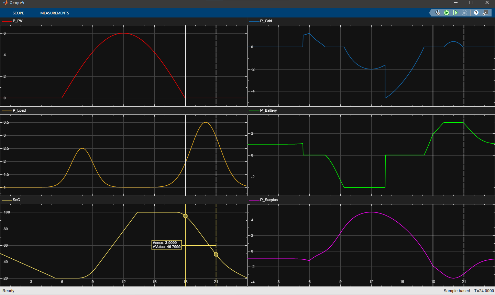

# ELM-4040 Alternative Energy Systems and Modeling — Simulink

Simulink models from ELM-4040 Alternative Energy Systems and Modeling at YTU
(Fall 2026/27): weekly class exercises and homework. The course builds energy
system models step by step, from basic blocks and differential equations to
rule-based energy management and Specialized Power Systems circuits.

This repository grows during the semester as new weeks and homework are added.

## Contents

| Folder | Topic |
|--------|-------|
| `week1-rc-circuit/` | RC charging voltage from its closed-form solution, built twice: with an `Fcn` block and with a MATLAB Function block |
| `week1-rule-based-ems/` | Rule-based PV / battery / grid power split with constant inputs (the "W1S8" model the homework starts from) |
| `week2-ac-power/` | Instantaneous and RMS power from sampled AC voltage and currents |
| `week3-differential-equations/` | Solving differential equations with Integrator blocks; the RC circuit as an ODE and as a Simscape circuit |
| `week4-ac-power-measurement/` | Series RLC branches on an AC source with Specialized Power Systems power and RMS measurement |
| `homework1-solar-home-ems/` | Homework 1: solar home energy management with battery SOC (see below) |

## Week 1 — RC Circuit

`Vc(t) = Vs + (Vc0 − Vs) · e^(−t / RC)` with Vs = 24 V, R = 0.1 Ω, C = 1000 µF.

## Week 1 — Rule-Based EMS

Constant PV, load and SOC values go through Compare, Interval Test and Switch
blocks that decide how the surplus `P_PV − P_Load` is split between the
battery and the grid.

## Homework 1 — Solar Home Energy Management

A 24-hour solar home model (1 simulation second = 1 hour, fixed-step ode1,
Ts = 0.01 h) with:

- PV: `P_PV = 6 · sin(π(t − 6)/12)` for 6 ≤ t ≤ 18 h, otherwise 0 [kW]
- Load: `P_Load = 1 + 1.5·e^(−((t−8)/1.5)²) + 2.5·e^(−((t−20)/2)²)` [kW]
- Battery: SOC(0) = 50 %, limits 20–100 %, charge/discharge limit 3 kW
- Power balance `P_PV + P_bat + P_grid = P_Load` (P_bat > 0 discharging, P_grid > 0 importing)
- Time-of-use import tariff (5 / 3 / 10 / 5 TL/kWh), export price 5 TL/kWh

Personal parameters: a.b = 8.0, so E_bat = 18 kWh and the report times are
t1 = 9 h, t2 = 16 h, t3 = 22 h.

| Model | Part |
|-------|------|
| `part1_daily_profiles.slx` | PV and load profiles, surplus hours, daily energies with Integrators |
| `part2_soc_w1s8_rule.slx` | SOC from `−100/E_bat · ∫P_bat dt`, driven by the unchanged W1S8 rule |
| `part3_ems_rules.slx` | Proper EMS rules with only Relational Operator and Switch blocks, including min(·, 3 kW) limits |
| `part4_energy_and_money.slx` | Charged / discharged / imported / exported energy, import cost with the tariff, export revenue and net bill |

### Part 1 — Daily profiles

Daily energies from the integrators: E_PV = 45.84 kWh, E_Load = 36.83 kWh.

### Part 2 — SOC with the W1S8 rule

### Part 3 — Energy-management rules

With the 3 kW limits the battery charges at most 3 kW and the rest of the
surplus is exported; once SOC reaches 100 % the whole surplus goes to the grid.

### Part 6 — The 18–21 h peak tariff

## Notes

- Most models are saved in R2026a; `week4-ac-power-measurement` is saved in R2025b.
- `week2-ac-power/ac_power_signals.m` creates the `x` signal the model reads with From Workspace; run it before the model.
- The course handouts are not included here.

## Tools
MATLAB / Simulink, Simscape Electrical
